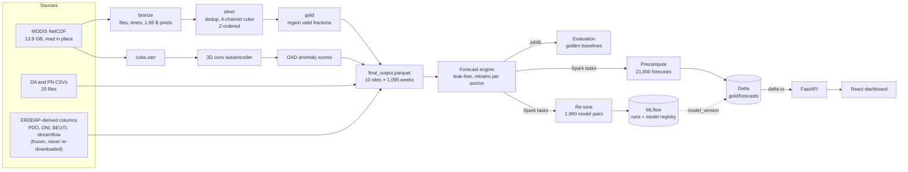

# Data engineering in DATect

DATect forecasts domoic acid (DA), a shellfish toxin, one week ahead at 10 Pacific
Northwest beaches. Behind the model sits a set of data systems:

- a Delta Lake over 13.9 GB of MODIS satellite imagery;
- forecasting models trained in parallel on Spark and tracked in MLflow;
- a batch-inference path that serves precomputed forecasts from Delta;
- the reproducibility, leakage and data-quality work that makes the numbers trustworthy.

This page is the overview. It says what each system does, how it was verified and
where its code and results live. Detailed results are in
[`datect_spark/RESULTS.md`](../datect_spark/RESULTS.md), and every model metric is in
[`CORRECTED_NUMBERS.md`](CORRECTED_NUMBERS.md).

**Scope, stated plainly.** Everything runs on open-source Spark 4.0, Delta Lake 4.0 and
MLflow 3.17 on the University of Washington's Hyak cluster (Slurm), one node per job
in Spark local mode. It is not Databricks; [a table below](#how-this-maps-to-databricks)
maps each piece to its Databricks equivalent.

## At a glance

| System | Result | Verified by |
|---|---|---|
| MODIS → Delta Lake (bronze / silver / gold) | 13.90 GB, 2,563 NetCDF files → 1.96 billion pixel rows → 374 million cube rows → 23,460 region rows | Gold equals the existing pipeline's output exactly (23,460 / 23,460 rows); five sampled dates are bitwise identical to the existing `cube.zarr` |
| OPTIMIZE + Z-ORDER | A region query reads 28–69% fewer bytes; bronze file count 2,584 → 130 | File statistics in the Delta transaction log |
| Distributed training + MLflow | 1,990 XGBoost + Random Forest pairs, 8.7× task time over wall time on 16 cores, 2,990 MLflow runs | Predictions equal the committed evaluation exactly (max abs diff 0.0, 1,044 rows) |
| Batch inference | 21,900 forecasts in 2.19 h wall (26.0 h of task time, 11.9×), 16.9 MB Delta table | 50 / 50 random entries equal a fresh on-demand run in every value and type |
| Serving from Delta | API latency p50 3.28 s → 0.12 s, p95 10.6 s → 0.13 s | All 20 timed responses byte-identical to the on-demand API (sha256) |
| Reproducibility | Every behavior-neutral refactor reproduced the golden baseline byte for byte | `scripts/eval/compare_golden.py` on Hyak |
| Leakage audit | Three train/test leaks found and fixed; headline holdout R² now 0.516 [0.308, 0.654] | `tests/test_leakage_audit.py`, deterministic chronological evaluation |
| Data quality | 339 non-detects, 1,604 PN counts with thousands separators, ~1,200 duplicate site-days handled | The published holdout R² of 0.485 is shown to come from file order (0.419 once fixed) |
| Dashboard | JavaScript 5.07 MB → 2.40 MB; first page load 1,586 KB → 56 KB gzipped | `vite build` |

## Architecture



One forecast engine (`forecasting/raw_forecast_engine.py`) has two executors. joblib
runs the evaluations, on a laptop or in CI. Spark runs the same per-forecast function
as one task per forecast, so its outputs can be, and are, checked against joblib's
exactly.

## 1. Lakehouse: MODIS imagery into Delta Lake

Two forecast features measure how much of each coastal region a satellite could see
that week; the anomaly score is confounded by cloud cover (r ≈ 0.4–0.5). They come
from 8-day MODIS Aqua composites of chlorophyll-a, Kd490, fluorescence line height
and sea-surface temperature, 2003–2024. `datect_spark/modis_lake.py` turns those
files into a three-layer Delta Lake.

**Input.** 2,563 NetCDF files, 13,904,484,780 bytes, already on Hyak, read in place.
NOAA's ERDDAP servers are too unreliable to download from again, so the pipeline
never fetches anything. Every file shares one 321 × 409 grid (0.025°), which the job
checks from a hash of the coordinates. It skips 29 macOS `._` stub files, as the
original pipeline's glob did.

| Layer | Table | Rows | Size | Notes |
|---|---|---:|---:|---|
| bronze | `satellite_files` | 2,563 | 0.2 MB | Path, sort rank, bytes, **sha256 of every input byte**, grid hash |
| bronze | `satellite_times` | 26,417 | 5.1 MB | Every timestamp, fully cloudy ones included |
| bronze | `satellite_pixels` | 1,956,017,408 | 5.85 GB | Non-NaN pixels, decoded with `mapInPandas`, partitioned by channel and year |
| silver | `satellite_cube` | 373,593,583 | 4.06 GB | One source per (channel, time), times present in all four channels, pivoted, `valid` flag |
| gold | `oad_region_valid_frac` | 23,460 | 0.3 MB | Valid pixels ÷ pixels in each of 5 region boxes |

**Engineering details.**
- **Deduplication matches the original's rule.** 1,507 per-day files repeat composites
  that are already in the monthly files. Silver keeps the first file in the original's
  sort order, which reproduces its `drop_duplicates(keep="first")` and drops 1,749 rows.
- **Lineage from input byte to gold row.** The sha256 column ties every gold row back
  to the exact input files, and the Delta log records every version.
- **OPTIMIZE / Z-ORDER.** Silver is written in time order, so every file spans the whole
  grid and a region filter can skip nothing. `ZORDER BY (lon_idx, lat_idx)` clusters
  files spatially; Delta's per-file min/max statistics then skip 28–69% of the bytes
  for a region query. Compaction cut bronze from 2,584 files to 130. VACUUM brought
  the lake from a 21 GB peak to 12.4 GB.

**Parity** (Hyak job 42764314, all exact):
- the gold table equals the committed `oad_cloud_fractions.parquet`
  (`assert_frame_equal(check_exact=True)`);
- silver's time axis equals `cube.zarr`'s, all 4,692 timestamps;
- five dates re-standardized from silver are bitwise identical to `cube.zarr`, mask
  and all four channels;
- the reference itself reproduces when re-run (job 42763175).

**Speed, honestly.** On one 16-core node, raw files to gold took 19.4 min on Spark
against 9.3 min for the original xarray script. Spark also hashes all 13.9 GB and
writes three queryable layers (about 2 billion rows), where xarray writes one dense
array. What the lake adds is SQL over every pixel, data skipping, time travel and
lineage, not speed on a single node. Multi-node runs were not measured.

Tests: `tests/test_modis_lake.py` (file order and stub skipping, decoded pixels against
the NetCDF, region pixel counts, the bitwise standardization, Delta log replay, grid
index order).

## 2. Distributed training on Spark, tracked in MLflow

The ensemble's per-site weights and clip quantiles are post-processing: a test
point's XGBoost and Random Forest models are the same whatever those settings are.
So `datect_spark/retune.py` trains each test point's model pair once and then scores
every setting cheaply. The original grid search re-ran the whole evaluation per
setting: 2,250 full retrospectives.

1. **`predict`.** One Spark task per real DA measurement. Each task trains that point's
   XGBoost + RF pair on that point's own pre-anchor data, through the engine's
   retrospective function, so it inherits the leak-free protocol. The
   predictions go to Delta.
2. **`score`.** Spark SQL applies the 100 weight × clip settings to the predictions and
   scores each (site, setting) on yearly folds 2015–2021.
3. **`holdout`.** Scores the chosen and the current settings once on 2022–2023, and
   chooses nothing there.

| | |
|---|---|
| Model pairs trained | 1,990 (1,581 tuning + 409 holdout points) |
| Wall time, 16 cores | 883 s |
| Task time | 7,710 s (8.7× the wall time) |
| MLflow runs | 2,990: 1,990 forecast runs + 1,000 (site, setting) scoring runs |
| Parity | The current setting rebuilt from Spark's predictions equals the committed evaluation exactly |

**What MLflow records.** Each `predict` run is a parent run, with params (window,
dates, git SHA) and metrics (point count, successes, child count). Each forecast is a
child run: site, test date and training rows as params; predictions, error and task
seconds as metrics. Child runs are written with `MlflowClient.log_batch`, one call per
run, instead of thousands of separate logging calls. The tracking store and model
registry are a SQLite file on Hyak.

**Getting identical numbers out of Spark workers:**
- every thread-count variable is pinned to 1 before any JVM or Python worker starts;
- `TZ=UTC` and the Spark session time zone are set;
- seeds and settings travel as environment variables, because workers re-import
  `config` and never see changes patched into the driver.

**Outcome.** The per-site picks tied one shared rule on the holdout, so they were not
adopted. The re-tune independently chose "no clip" at 7 of 10 sites, which supported
removing the clip (`0f4466d2`, holdout R² 0.497 → 0.550 before the next fix).

## 3. Batch inference: serving precomputed forecasts from Delta

**The problem.** A dashboard forecast retrains the evaluated models on data up to the
anchor date (that's what makes it leak-free), so each request took seconds: p50
3.28 s, p95 10.6 s, worst 16.6 s.

**The design.**
1. `datect_spark/forecast_serving.py precompute` runs the dashboard's forecast for every
   (site, week) on Spark: 10 sites × 1,095 Mondays × 2 tasks = 21,900 forecasts. It
   stores each output unchanged, as lossless JSON, in `gold/forecasts`. Every row also
   carries `model_version` and a `config_hash`.
2. The API (`backend/precomputed_forecasts.py`) loads the table at startup with
   **delta-rs** (the Rust `deltalake` package, no JVM in the web server) into an
   in-memory dict. A lookup and decode takes about 25 µs.
3. **A stale table never serves.** The config hash covers the engine code, config, tuned
   parameters, data and library versions. A row whose hash differs from the running
   code is ignored, and the API computes on demand as before. Responses report
   `source` (`precomputed` or `computed`) and `model_version`.

**MLflow Model Registry.** `datect-forecaster` version 1 is a pyfunc that wraps the
forecast procedure. It's a procedure rather than a fixed fitted model, because DATect
retrains for every anchor. Its tags record the config hash, git SHA, grid, Delta table
version, entry count and wall time. Every table row carries
`model_version = datect-forecaster/1`, so any forecast on the dashboard traces back to
a registered version and a commit.

| `POST /api/forecast/enhanced`, same 20 requests, same node | Before (on demand) | After (Delta) |
|---|---:|---:|
| p50 | 3.283 s | **0.122 s** (27× lower) |
| p95 | 10.628 s | **0.127 s** (84× lower) |
| max | 16.625 s | 0.128 s |

**Parity** (all exact):
- 50 of 50 random entries equal a fresh on-demand run in another process, floats
  bitwise;
- the registered pyfunc reproduces 3 of 3 entries;
- all 20 timed responses equal `main`'s byte for byte (sha256);
- single-threaded XGBoost on Spark matches the API's multithreaded XGBoost.

**Limits.**
- Only weekly dates and the `ensemble` model are precomputed. A daily grid was
  estimated at 11.4 node-hours, against a 2-node-hour budget.
- `linear` can't be precomputed exactly, because its interval bootstrap draws from
  NumPy's global RNG and changes from call to call.
- Any change to code, config or data makes the table stale until it is recomputed.

Tests: `tests/test_precomputed_forecasts.py` (lossless codec, strict equality, config
hash stability, hits, misses, stale rows, an unreadable table, both endpoints).

## 4. Reproducibility engineering

- **Golden baselines.** `scripts/eval/golden_baseline.sh <ref> <label>` evaluates any git
  ref in a disposable copy on Hyak. `compare_golden.py` then requires every prediction
  parquet to match byte for byte, and metric tables to match within 1e-12 rounding.
  Every behavior-neutral refactor in the October 2026 cleanup passed this gate. Each
  behavior change went in its own commit, with before/after numbers in the message.
- **Exact parity as the acceptance test.** No Spark job counts as done until its output
  equals the existing pipeline's exactly: the re-tune predictions, the MODIS gold
  table and cube, the precomputed forecasts and the API responses.
- **Seeds kept apart.** `MODEL_SEED = 42` seeds every model. `RANDOM_SEED` only picks
  sampled test points, so the choice of points and the models' randomness never
  interact, whether the forecasts run serially, on joblib or on Spark.
- **Nondeterminism found and documented:**
  - the `linear` model's bootstrap RNG;
  - `np.polyfit`'s last bits differ across machines, so rebuilds recompute only what
    changed;
  - test points used to depend on sort order (section 6).

## 5. Leak-free time-series protocol

Each forecast for date *t* is anchored at *t* − 7 days. Training rows and the anchor
row use only weeks that end by the anchor (`date + 6 days <= anchor`). Persistence
features and the naive baseline come from raw daily measurements dated on or before
the anchor. Test points are raw measurements only, never gap-filled values. An audit
found three ways the pipeline broke this, each fixed in its own commit:

| Commit | Leak | Effect |
|---|---|---|
| `e14db2eb` | Training rows' "last observation" included the row's own target (equal on all 4,447 real-measurement rows) | The model learned to copy it and lagged every onset. Fixing it raised holdout R² 0.419 → 0.458 |
| `2688fb8d` | Weekly rows dated on or before the anchor held up to six days after it | Removed real future information (about 23% of evaluation points' PN maximum) |
| `c099f20b` | Forecast rows' lags stopped 13–19 days before the target, unlike training rows | Rebuilt like training rows; exact on 2,977 of 2,977 sampled rows; onsets caught 18 → 19 of 27 |

`tests/test_leakage_audit.py` guards the first two. The third has a property test
(`TestTestRowMatchesTrainingRows`) checking that forecast rows equal training rows.

## 6. Data quality

- **One measurement parser** (`forecasting/measurements.py`) shared by the dataset
  build, the evaluation targets and the API:
  - `"<1"` (below detection) → LOD/2 = 0.5 (339 readings);
  - Pseudo-nitzschia counts like `"12,345"` → 12345 (1,604 values that were dropped
    before);
  - whitespace stripped from dates.
- **Same-day duplicates.** About 1,200 site-days have several samples that disagree
  (Gold Beach on 2019-01-24 recorded 0 and 190 µg/g), and the CSVs say nothing about
  which is right. The evaluation used to score whichever sample sorted first, so the
  published holdout R² of 0.485 depended on file order. Scoring each site-day at its
  maximum, like the weekly maximum used everywhere else, gives 0.419. The model was
  not worse; the target had been arbitrary.
- **Offline rebuild, no re-download.** `scripts/data/rebuild_final_output.py` rebuilds
  the feature table from the committed one. It keeps every ERDDAP-derived column
  frozen and recomputes only what comes from local files (DA, PN and OAD features).
  Before the new parser was switched on, the rebuild with the old parser had to
  reproduce the committed parquet byte for byte.

## 7. Satellite ML features

A 3D convolutional autoencoder (`oad/`, four frames of context) learns normal ocean
states from the four-channel MODIS cube and scores how anomalous each of five coastal
regions looks. Scores are lagged so the 8-day composite behind them ends before the
anchor (score at test date − 12 days). The in-region valid-pixel fraction (section 1)
is a parallel feature, because the anomaly score correlates with cloud cover. The
honest result: the scores track *Pseudo-nitzschia* at the offshore mooring but add
no forecast skill at the beaches, and the ablation keeps them only because they do
no harm.

## 8. Running on an HPC cluster (Hyak)

- **Slurm.** Jobs use the checkpoint partition with `--requeue`, so a preempted job
  restarts by itself, and long multi-step jobs skip steps they already finished. 16 cores
  and 32 GB is enough: evaluations peak under 6 GB, and 32-core / 96 GB requests sat
  pending for hours.
- **Spark on Slurm.** `local[16]` on one node with Java 17 from the cluster's module
  system. The Spark environment is a venv layered on the existing conda environment
  (`--system-site-packages`), with a constraints file pinning numpy, pandas,
  scikit-learn and XGBoost. That kept model outputs identical and stayed within a
  group allocation at 98% of disk and 94% of files.
- **Shared filesystems under pressure.** Both scratch filesystems were 98–99% full and
  intermittently refused writes (EDQUOT) even though our own use was small. Jobs now
  run from a `git archive` on the node's local disk, read the MODIS files in place,
  and copy only their results out (`datect_spark/hyak_stage.sh`).
- **Operating etiquette.** The login node blocks an IP after repeated failed SSH
  attempts, so jobs are watched with one server-side wait, never a polling loop from
  a laptop.

## 9. Uncertainty and pre-declared decisions

An 80% conformal error band now surrounds the forecast line (`forecasting/conformal.py`,
`docs/ERROR_BAND.md`, PR #19). Each forecast is calibrated only on errors of forecasts
already measured by its anchor, the same cut-off as the model. A test rewrites every
later measurement and checks that the band does not change. The protocol and decision
rule were committed before the holdout was scored.

- **Coverage:** 0.802 on the holdout.
- **Not calibrated per site:** 0.375 at Gold Beach.
- **The spike classifier stays:** the declared test found the band's spike probability
  could not replace it (16 vs 19 onsets caught out of 27).

## 10. App performance

- **Smaller frontend bundle.** Only the four Plotly trace types the app draws are
  bundled, pages are lazy-loaded, and production source maps are off. JavaScript fell
  from 5.07 MB to 2.40 MB, the first page load from 1,586 KB to 56 KB gzipped, and the
  deployed `dist` from 25 MB to 2.5 MB.
- **A non-blocking API.** All 19 handlers were `async def` with no `await`, so one long
  forecast blocked every other user. They are plain `def` now and run in FastAPI's
  thread pool.
- **Live headline numbers.** The dashboard reads them from `GET /api/metrics/summary`
  instead of hard-coding them.

## What runs where

Spark is the scale-out executor and Delta the serving store. Evaluation stays on joblib
because it has to run on a laptop and in CI without Java, and it is the reference that
every Spark output is checked against.

| Job | Path | Status (2026-11-03) |
|---|---|---|
| Evaluation (headline, golden, multi-seed) | joblib engine | Final: the reference implementation |
| Forecast serving | Delta `gold/forecasts` via delta-rs, on-demand fallback | Built. Deployed default: **in progress** |
| Dashboard precompute (retrospective, spectral, heatmaps) | JSON files in `cache/` with optional Redis | Moving into Delta: **in progress** |
| Ensemble weight tuning | Two tuners, `scripts/tune/grid_search_weights_clip.py` and `datect_spark/retune.py` | Spark tuner only: **in progress** |
| Cloud fractions for the forecast features | xarray script and the Delta gold table (identical outputs) | Delta lake as the producer: **in progress** |
| Autoencoder training data | `cube.zarr` from `oad/scripts/02_build_cube.py` | Stays: the autoencoder trains on the dense cube |

On 2026-11-03 the four "in progress" rows were approved to move onto the Spark / Delta
path, with each duplicate deleted once its replacement reproduces the old output
exactly. This table is updated when that lands.

## How this maps to Databricks

| Here | On Databricks |
|---|---|
| Spark `local[16]` on a Slurm node | A Databricks Jobs cluster or serverless compute |
| `delta-spark` writes, OPTIMIZE, ZORDER BY, VACUUM | The same Delta commands; liquid clustering is the newer alternative to Z-ordering |
| bronze / silver / gold tables in a path-based lake | The medallion architecture, as Unity Catalog tables |
| sha256 per input file plus the Delta log | Unity Catalog lineage |
| Reading a fixed set of NetCDF files | Auto Loader, for files that keep arriving |
| `mapInPandas`, one task per forecast | The "many models" pattern with pandas UDFs / `applyInPandas` |
| MLflow on SQLite, pyfunc in the registry | Managed MLflow and Models in Unity Catalog |
| Precompute to Delta, delta-rs lookup in the API | A batch inference job writing a Delta table, served through a low-latency serving layer |

## Caveats

- Every Spark job ran on one node in local mode; multi-node scaling was not measured.
- On one node, Spark was 2× slower than xarray for the MODIS pipeline. The gain is the
  lake, not speed.
- "13.9 GB" is the satellite imagery alone. The tabular features were not rebuilt on
  Spark, and the ERDDAP-derived columns are frozen by policy.
- The 0.12 s latency applies to precomputed weekly dates and the `ensemble` model;
  anything else is computed on demand at the old latency.
- MLflow tracking is a SQLite file without a tracking server; `mlflow ui` can open it.

## Reproduce

```bash
# Hyak, from a checkout of this branch (logs outside the full filesystems)
L="-o $HOME/datect-spark-logs/%x-%j.out -e $HOME/datect-spark-logs/%x-%j.err"
sbatch $L datect_spark/modis_lake.sbatch                                  # MODIS -> Delta + parity
sbatch $L --export=ALL,STEPS=reference datect_spark/modis_lake.sbatch     # timed xarray reference
sbatch $L --export=ALL,MAIN_SHA=$(git rev-parse origin/main) datect_spark/serving.sbatch
sbatch datect_spark/retune.sbatch    # re-tune + MLflow, from a disposable worktree (being updated for the no-clip config)

# Golden baseline for any git ref, then compare two runs
bash scripts/eval/golden_baseline.sh <git-ref> <label>
python scripts/eval/compare_golden.py <golden_root>/<a> <golden_root>/<b>

# Serve precomputed forecasts locally
DATECT_FORECAST_TABLE=/path/to/gold/forecasts python3 run_datect.py
```

## Code map

| Path | What it is |
|---|---|
| `datect_spark/session.py` | Spark session with Delta, pinned threads and UTC; MLflow setup |
| `datect_spark/modis_lake.py` | MODIS bronze / silver / gold, OPTIMIZE, Z-ORDER, VACUUM, parity |
| `datect_spark/retune.py` | Distributed re-tune with MLflow tracking |
| `datect_spark/forecast_serving.py` | Spark precompute, MLflow registry, serving parity |
| `datect_spark/hyak_stage.sh`, `*.sbatch` | Node-local staging and Slurm jobs |
| `backend/precomputed_forecasts.py` | delta-rs loader, config hash, lookup with fallback |
| `scripts/eval/forecast_latency.py` | Before/after latency harness |
| `scripts/eval/golden_baseline.sh`, `compare_golden.py` | Golden baselines and byte-level comparison |
| `scripts/data/rebuild_final_output.py` | Offline feature rebuild, no downloads |
| `forecasting/measurements.py` | The shared measurement parser |
| `results/spark_lake/`, `results/serving/`, `results/tuning_provenance/retune_spark/` | Result JSONs behind every number above |
