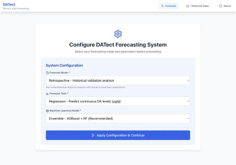
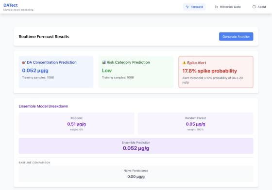
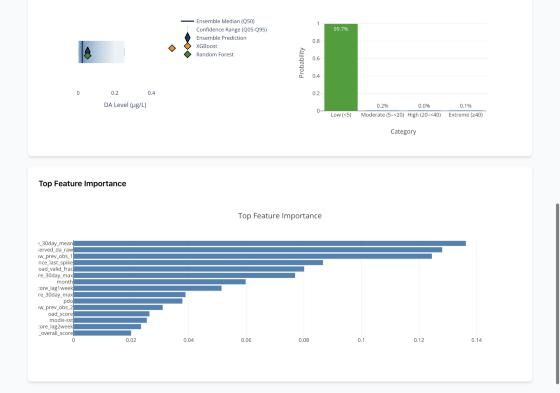
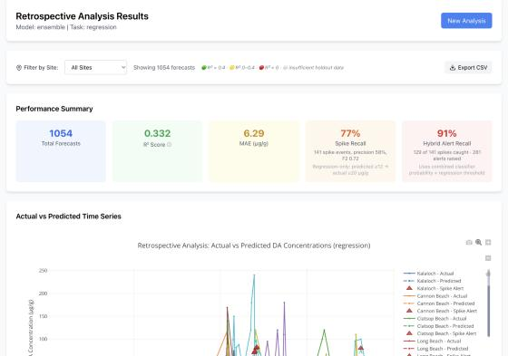
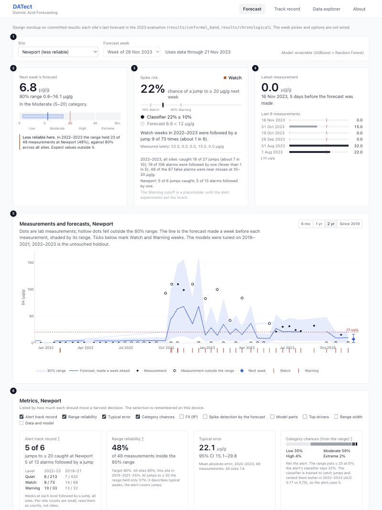
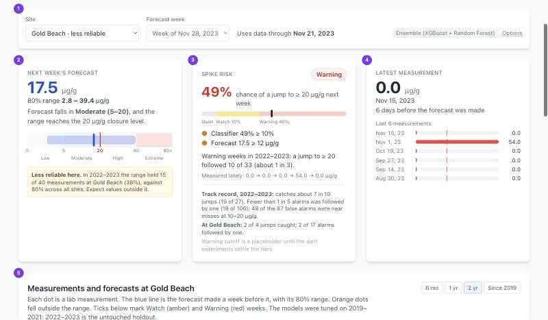
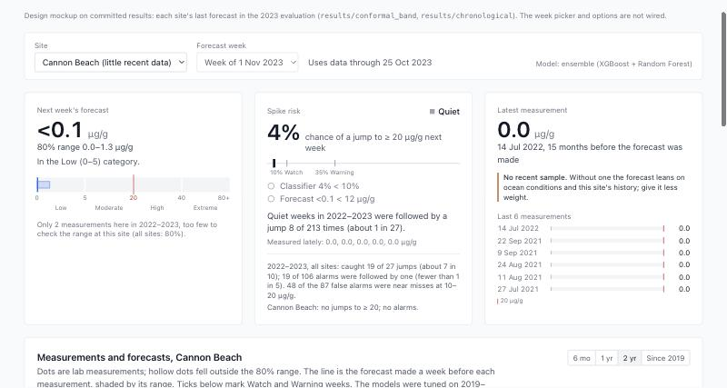
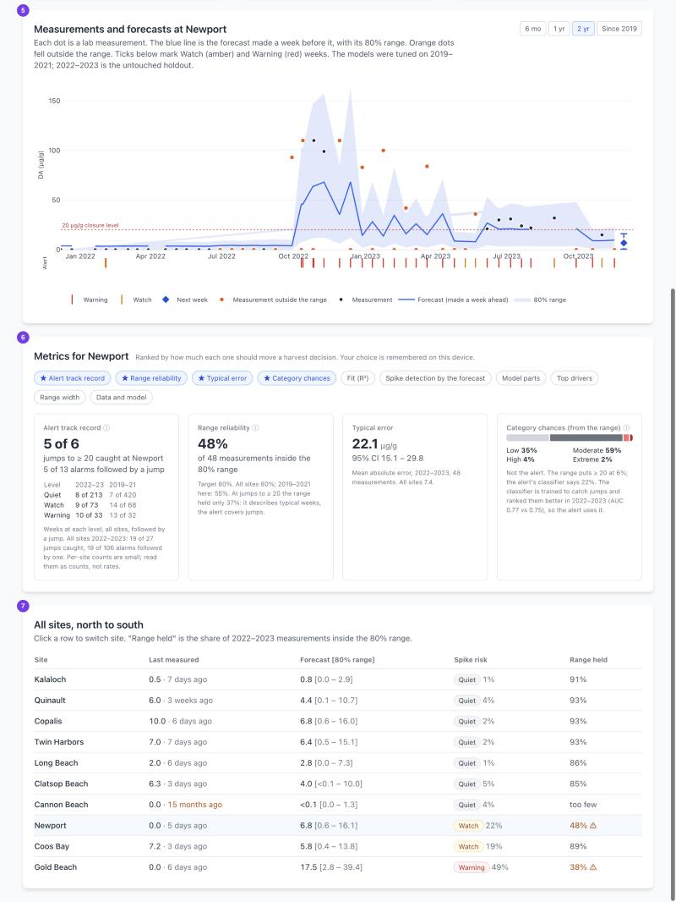

# Decision-support dashboard: design

**Date:** 2026-11-03
**Branch:** `claude/dashboard-redesign-26311d` (phase 1: design only; no frontend changes)
**Status:** Approved 2026-11-03
**Mockup:** the throwaway HTML mockup was removed when the real page landed; only its
`dashboard-mockup/screenshots/` remain.

## 1. Who it is for, and what they ask

A person deciding about next week's shellfish harvest at one beach. In the user's words, the
dashboard should "give a full picture to best inform them ... a wide variety of metrics to choose
from, some more priority than others ... still include the main error bar ... they can use those
metrics plus the ground data it shows to make the best decisions."

Their questions, in the order the page should answer them:

1. What will DA be next week, and how sure is that? (forecast and its 80% range)
2. Could it jump past 20 µg/g even if the forecast says it won't? (spike alert)
3. What did we last measure, and how long ago? (latest real measurements)
4. How far can I trust all this at this beach? (per-site track record)
5. Then the history, so they can judge for themselves (ground data with forecasts overlaid).

## 2. What the dashboard does today

Walked on `main` at `f1cecb2b` with the precomputed retrospective cache.

| View | Shows | Numbers come from |
|---|---|---|
| Forecast, config step | Mode (realtime / retrospective), task, model; nothing else until "Apply" | `GET /api/config` (default mode: retrospective) |
| Forecast, realtime result | Ensemble value, 4-category "risk", spike probability, XGB/RF/naive breakdown, interval chart, category bar chart, feature importance | `POST /api/forecast/enhanced`; interval chart rendered by the server |
| Forecast, retrospective result | Total, R², MAE, spike recall/precision/F2, "Hybrid Alert Recall", time series, scatter, per-site small multiples, CSV export | `POST /api/retrospective` rows; **metrics recomputed in the browser** once a site is filtered; hybrid recall and per-site R² always browser-computed |
| Historical Data | Correlation heatmap, sensitivity, DA vs Pseudo-nitzschia, waterfall, spectral, site map | `/api/visualizations/*` (server-rendered Plotly) |
| About | Static text | — |

What a harvest decision-maker runs into:

- **A configuration gate first.** The landing page asks for mode, task and model; it defaults to
  Retrospective, so the first thing a visitor sees is a validation study, not a forecast.
- **Contradictory risk numbers.** Cannon Beach, 2023-11-24: forecast 0.052 µg/g, risk category
  "Low" at 99.7%, and a red "Spike Alert, 17.8% spike probability" on the same screen. The 99.7%
  comes from an untested 4-category classifier; nothing explains which number to believe.
- **The interval is not the calibrated band.** The chart shows a bootstrap Q05–Q95 labelled
  "Confidence Range", not the 80% conformal band of `docs/ERROR_BAND.md`, and its axis reads
  µg/L (server-rendered).
- **The alert rule is misstated.** "Alert threshold: >10% probability" omits the other trigger
  (forecast ≥ 12) and uses > where the rule is ≥.
- **No anchor or measurement age.** The page never says what data the forecast used. In the 2023
  evaluation, Cannon Beach's last forecast rested on a measurement from July 2022, 15 months
  earlier.
- **Retrospective numbers are not the reported numbers.** The Performance Summary shows R² 0.332,
  MAE 6.29, N = 1,054: a 20% random sample (`TEST_SAMPLE_FRACTION`) mixing pre-2019, validation and
  holdout rows. The reported holdout is R² 0.516, MAE 7.44, N = 409 (`docs/CORRECTED_NUMBERS.md`).
- **"Hybrid Alert Recall 91%"** counts every reading ≥ 20, including ones already high the week
  before. On onsets the alert caught 19 of 27 on the holdout, and it fired in 29.8% of quiet
  weeks; the dashboard shows neither.
- **Mislabelled per-site panels.** The small multiples say "in-sample R²" (they are out-of-sample
  forecasts across mixed windows), recompute R² in JavaScript, and colour tiers with `> 0.4` where
  the dropdown uses `>= 0.4`.
- **Gap-filled values drawn as measurements.** `/api/historical/{site}`, the waterfall and the
  DA-vs-PN charts plot the weekly `da` column, which the decay fill completes (Newport, December
  2023: 5.16, 4.22, 3.46, 2.83 µg/g, none measured).
- **Defaults and precision.** The default site is Cannon Beach (2 holdout measurements); values
  print to three decimals (0.052 µg/g) where the typical error is about 7 µg/g.

## 3. Proposed Forecast page

One screen, no configuration step. The numbered callouts match the mockup.

1. **Filter row.** Site (options tagged "less reliable" or "little recent data"), forecast week
   (defaults to the latest precomputed week, as the Spark branch already does), and "uses data
   through <anchor>". The forecast page always shows the evaluated ensemble; model and task
   choices move to Track record.
2. **Next week's forecast.** Value to one decimal (`<0.1` below that), the 80% conformal range, the
   category the forecast falls in, and a bar with the four categories and the 20 µg/g closure
   line, so the reader sees whether the range reaches 20. Under it, the site's 2022–2023 range
   reliability in counts ("held 23 of 48 measurements at Newport (48%), against 80% across all
   sites"), marked with an amber rule when the site is below 70% with at least 10 holdout rows.
3. **Spike risk.** Graded, not a single alarm (see "Spike risk, graded" below): the classifier's
   probability of a jump to ≥ 20 µg/g on a Quiet / Watch / Warning bar; which conditions hold
   (classifier ≥ 10%, forecast ≥ 12); what weeks at this level were followed by in 2022–2023
   ("a jump followed 9 of 68 Watch weeks"); the last five measurements as a trend line; and the
   track record in plain words, overall and at the site.
4. **Latest measurement.** Value, date, and age relative to the forecast's anchor; the last six
   real measurements as small bars against the 20 line. "No recent sample" (amber rule) when the
   newest one is more than 21 days older than the anchor.
5. **Measurements and forecasts (ground data).** Real measurements as dots, hollow when outside
   the range; the forecast each one was given a week earlier as a line with its 80% range; next
   week's forecast with its range at the right edge; a strip of ticks for Watch and Warning weeks;
   the 20 µg/g line. Range buttons 6 mo / 1 yr / 2 yr (default) / since 2019.
   Line and range break across gaps of more than three weeks, so they never imply forecasts that
   were not made. Hover gives date, measured, forecast and range, inside/outside, classifier
   probability.
6. **Metrics for <site>.** A row of checkboxes chooses which tiles show, in rank order (below);
   the first four are on by default and the choice is remembered in the browser.
7. **All sites, north to south.** Last measurement and its age, forecast and range, spike-risk
   level, range held in 2022–2023, with footnote marks for stale samples and unreliable ranges.
   Clicking a row switches the site. It stays at the bottom: the page answers one site's
   question first, but blooms move along the coast, so a rise at a neighbouring beach is early
   warning in itself.

The same page in two other states:

### Spike risk, graded

The user does not want a boy-who-cried-wolf alert, and a warning that arrives after the rise is
useless. The hybrid alert's 2022–2023 record on weeks whose last known value was below 20:

| | Holdout 2022–2023 | Validation 2019–2021 |
|---|---:|---:|
| Onsets (jumps to ≥ 20) caught | 19 of 27 | 27 of 34 |
| Alarms followed by a jump | 19 of 106 (18%) | 27 of 100 (27%) |
| False alarms per caught onset | 4.6 | 2.7 |
| False alarms that were near misses (measured 10–20) | 48 of 87 | 37 of 73 |
| False alarms below 5 | 21 of 87 | 23 of 73 |

So the card shows a level instead of a red light:

- **Quiet** (gray, never green): no alert condition holds.
- **Watch** (amber): today's hybrid alert, unchanged (classifier ≥ 10% or forecast ≥ 12).
- **Warning** (red): the classifier at or above 35%. The onset experiments chose that cutoff on
  validation, never on the holdout (`docs/FORECAST_EXPERIMENTS.md` section 6.2).

Next to the level, the card says what that level has meant. Weeks followed by a jump were:

| Level | 2022–2023 | 2019–2021 |
|---|---:|---:|
| Quiet | 8 of 213 | 7 of 420 |
| Watch | 9 of 68 | 13 of 63 |
| Warning (≥ 35%) | 10 of 38 | 14 of 37 |

The card also states the track record in plain words ("catches about 7 in 10 jumps (19 of 27);
fewer than 1 in 5 alarms was followed by one (19 of 106); 48 of the 87 false alarms were near
misses at 10–20"), the site's counts ("At Newport: 5 of 6 jumps caught; 5 of 13 alarms followed
by one"), and the last five measurements, so the reader sees a rise the model may lag. When the
last measurement is already ≥ 20, the card says so and drops the level: the alert is for jumps
from below 20, and the forecast and measurements carry that week.

Tiers, cutoffs and their labels come from `/api/config`, and the per-level counts from the API,
so new tiers from the experiments need no frontend change.

### Two P(DA ≥ 20) numbers

The pooled spike classifier's probability drives the alert, and it is the only probability on the
spike-risk card. The band also implies a chance of ≥ 20 (the share of past errors that would carry this
forecast to 20). It appears only in the "Category chances (from the range)" tile, labelled
**Not the alert**, next to the classifier's number and the reason: the classifier ranked holdout
onsets better (AUC 0.773 vs 0.747), and the declared one-model test kept it (`docs/ERROR_BAND.md`).
Newport in the mockup is the case to design for: classifier 22% (alert), band 6%.

### Metrics, ranked

| # | Tile | Why it ranks here | Source | Default |
|---|---|---|---|---|
| 1 | Alert track record: jumps caught and alarms followed by a jump (site counts + all sites); weeks followed by a jump at each level, holdout and validation | The alert is the early warning; its misses and false alarms are the cost of acting on it | per-site onset counts and per-level counts (new) + `overall.onset` | on |
| 2 | Range reliability: share of 2022–23 measurements inside the 80% range, site vs all; at onsets only 37% | Says whether the error bar can be taken at face value here | `band_eval.json` coverage by site (new) | on |
| 3 | Typical error: MAE with 95% CI, site vs all | Size of a normal miss, in µg/g | `/api/metrics/summary` `per_site` | on |
| 4 | Category chances from the range, with "not the alert" | Spreads the band over Low/Moderate/High/Extreme | band-derived probabilities (planned) | on |
| 5 | Fit: R² with CI (and log R²), site vs all | Familiar to scientists; dominated by a few large values | `per_site` | off |
| 6 | Spike detection by the forecast: recall, precision, F2 of forecast ≥ 12 for readings ≥ 20 | The regression path of the alert alone | `per_site` | off |
| 7 | Model parts: XGBoost, Random Forest, last value carried forward, weights | Shows when the models disagree | forecast response | off |
| 8 | Top drivers: feature importance with plain names | Context, not cause | forecast response | off |
| 9 | Range width vs the holdout median (15.1 µg/g) | A wide range is itself information | forecast band | off |
| 10 | Data and model: data through, training samples, precomputed or computed, model version | Provenance | forecast response | off |

Every tile states its window and N. Per-site onset counts are small (27 onsets across 9 sites), so
they are shown as counts, never as rates.

## 4. Other pages

- **Track record** (replaces the Retrospective mode). Window selector, holdout by default, then
  validation; site filter. Data: the deterministic chronological runs
  (`results/chronological/*_20220101_20240101` and `*_20190101_20220101`), through a new endpoint
  that takes a window and returns its summaries and rows (section 6); every number is computed by
  the API, never in the browser. Predicted-vs-actual chart with the band, a per-site table (N, R²,
  log R², MAE, range held, onsets caught of N, alarms followed by a jump), and the model comparison
  from the same rows: ensemble against last value carried forward (`naive_prediction`) and Ridge
  (`predicted_da_linear`). CSV export stays. The 20%-sample `/api/retrospective` and the
  regression/classification task switch go: categories come from the band, and the 4-category
  classifier is being retired (my call).
- **Data explorer** (renamed Historical Data). Keeps its research charts. The waterfall and
  DA-vs-PN charts are rendered by the server from the gap-filled weekly series; the frontend
  labels them "weekly, gaps filled" until the API session switches them to raw measurements
  (section 6).
- **About.** Adds what the dashboard cannot do: the range is calibrated over all sites, not per
  site; the alert misses about 3 in 10 onsets, and fewer than 1 in 5 of its alarms were followed
  by a jump in 2022–2023; data ends in December 2023.
- **Data currency banner** on every page when the newest measurement is more than 30 days before
  today: "Forecasts use data through <date>; they are not live." Today that is every visit.

## 5. Frontend cleanup folded into phase 2

From the duplicate audit, done while rebuilding the pages above:

- Delete `calculateRegressionMetrics` / `calculateClassificationMetrics` and the inline R² and
  hybrid-recall code in `Dashboard.jsx`; show the API's summaries.
- Read thresholds (20, 12, 0.10), category bins and labels, eval windows and the band level from
  `GET /api/config`; fix ">10%", ">12", "2022-24" and "in-sample".
- Remove the dead fallback interval chart (`Dashboard.jsx` ~584-703) and the hard-coded model
  dropdown (use `/api/models`).
- Draw the conformal band on the Track record predicted-vs-actual chart.
- Split `Dashboard.jsx` (1,200 lines) into per-card components.

## 6. API needs (owned by the engine/API session)

Proposed names; the API session decides the shapes.

- **Forecast response:** `band {lo, hi, level, n_calibration}` and band-derived
  `category_probabilities` (both planned); `band_p_exceed`; the alert's parts
  (`classifier_probability`, `by_classifier`, `by_regression`, and the level once tiers exist);
  `anchor_date` at top level; `last_measurement {date, value}` and `recent_measurements` (last 6
  real ones up to the anchor, one per site-day at the max, as `load_raw_da_measurements` returns
  them); `model_version` (exists). A regression-only forecast endpoint, or `/api/forecast/enhanced`
  without the 4-category classifier, so a cache miss costs one model run, not two.
- **Site history:** per real measurement, the forecast made for it with its band, classifier
  probability and alert (`band_predictions.parquet` columns), from 2019 on, with an optional
  `until` date. This feeds both the ground-data chart and the Track record chart.
- **Track record endpoint:** for a window (validation or holdout), the chronological rows
  (ensemble, naive, linear, band, alert) and the API-computed summaries, overall and per site.
- **Per-site reliability** in `/api/metrics/summary`: band coverage (holdout, validation), onset
  counts (onsets, caught, quiet weeks, quiet weeks alarmed), and per alert level the weeks and the
  weeks followed by a jump; overall band coverage, coverage at onsets and median width. Each
  summary names the commit or model version it was computed from.
- **`/api/config`:** spike threshold, regression alert threshold, alert levels (name, rule,
  cutoff), category bins and labels, eval windows, band level, and the newest raw measurement
  date (for the banner).
- **All sites at once:** one week's forecast for every site in one call (default: the latest
  week), so the table does not cost ten requests.
- **Server-rendered charts:** the waterfall and DA-vs-PN charts and `/api/historical/{site}` use
  the gap-filled weekly `da`; switch them to raw measurements or label them. The interval chart's
  axis says µg/L. `_compute_summary` puts Clatsop Beach and Cannon Beach in Washington (both are
  in Oregon).

## 7. Visual style

The user wants it simple and scientific, with colour used sparingly. Read it like a figure in a
paper, not a product page.

- **Colour budget, one meaning each:** blue = the model's output (forecast, range); red = the
  20 µg/g line and the Warning level; amber = the Watch level and caution notes. Everything else
  is black and grays. Measurements are black; outside the range they are hollow, not recoloured.
  Category bars are a gray ramp.
- **No tinted cards, no emoji, no pill badges, no icons in headings.** White panels with a 1px
  gray border and no drop shadow; a caution is a thin amber rule beside plain text, not a
  coloured box. A level is a small square plus its word.
- **Typography:** the system sans already in use; sentence-case labels in gray-500; large
  values in semibold black; tabular figures where numbers line up (tables, lists, axes).
- **Charts:** hairline axes and grid, no chart titles inside the plot (the panel heading names
  it), legend below, a dotted red line only for the 20 µg/g threshold.
- **Controls:** plain selects, a segmented range control, checkboxes for metrics.
- Phase 2 applies this to every page, so the current emoji (🎯 📊 ⚠️ ✅ 💡 🟢), coloured stat
  cards and blue/green/purple panels go too.

## 8. Goals, non-goals, anti-goals

- **Goals:** the five questions answered on one screen without configuration; every number names
  its window and N; no metric computed in the browser that the API reports; the current look
  (Tailwind, gray-50 page, white cards, blue accents, trimmed Plotly).
- **Non-goals:** new models, a new alert rule, per-site band calibration (an engine question),
  user accounts, a mobile app (the page must still work at phone width).
- **Anti-goals:** a green "safe to harvest" verdict; hiding the weak sites; two unexplained
  P(DA ≥ 20); gap-filled values shown as measurements; more decimals than the error supports.

## 9. Calls made in this draft (check these)

- "Less reliable" = range held below 70% of at least 10 holdout measurements (today: Gold Beach,
  Newport).
- "No recent sample" = newest measurement more than 21 days before the anchor.
- Default site: the last one chosen in this browser, else Kalaloch (first north to south).
- The category bar gives each category a quarter of its width (0-5, 5-20, 20-40, 40-80+), so low
  values stay readable; it is labelled, not a linear axis.
- The forecast-week picker stops at the newest weekly row: past it the engine forecasts from
  stale data. Its earliest week is the dataset's first; weeks before the first band (fewer than
  30 past errors) show the forecast with "No range: fewer than 30 earlier forecast errors" (the API's `band_reason`).
- **Picking a past week** shows the page as it stood then: the ground-data chart, latest
  measurement and all-sites table stop at that week's anchor (history and all-sites calls take the
  date). A "Show what happened" toggle then adds the measurements that followed, so a past week
  can be checked against its outcome. The track-record tiles stay on the 2022–2023 holdout and say
  so; they describe the model, not the data the forecast used.
- **Model versions.** The forecast and the saved evaluation can come from different model versions
  after a retune. The Data and model tile shows the forecast's model version and the
  evaluation's source; the API has no per-summary version stamp, so there is no automatic
  mismatch flag.
- Watch is today's hybrid alert unchanged; Warning is the classifier at or above 35%. Quiet is
  gray, never green.
- Colours follow the budget in section 7.

## 10. Sequencing

Phase 2 starts from `main` after the Spark consolidation PR and the API work are merged: the API
fields above come first, then the Forecast page, then Track record, then the cleanup. Build
against the section 6 names with fixtures; a field that is not there yet hides its tile or line
rather than being computed in the browser. The mockup folder is deleted when the real page lands.

## 11. Decided with the user

1. **The all-sites table stays at the bottom of the Forecast page.** The single-site answer stays
   above the fold; the table shows neighbouring beaches, which can rise first, and switches
   site.
2. **"Quiet / Watch / Warning", with today's alert as an amber Watch.** The words follow the
   weather-service convention (a watch: conditions favour it; a warning: it is likely). Fewer than
   1 in 5 of today's alarms are followed by a jump, which does not earn red. Red is kept for
   Warning, whose cutoff the experiments chose on validation. Each level always carries its own record
   ("followed by a jump 9 of 68 times"), so the label cannot claim more than the data.
